# 🚀 Awesome Product-Led Growth (PLG) User Onboarding Guides

  

  
  
  
  
  
  
  

---

## 🧭 Executive Summary & SEO Overview

**Product-Led Growth (PLG)** relies on delivering value before demanding commitment. The cornerstone of any high-performing PLG engine is frictionless **User Onboarding** — leading prospective and new users to their first *"Aha! moment"* with minimal time-to-value (TTV) and zero manual friction.

This curated directory indexes the world's finest **SaaS Digital Adoption Platforms (DAP)**, **No-Code Product Tour Builders**, and **Open-Source Walkthrough Libraries**. Whether you need an enterprise-grade digital adoption engine or a headless, under-8KB React/Vue tour component that adheres to your strict design system, this guide provides side-by-side pricing, company scale, free tier limits, and GitHub traction metrics.

### 🔍 Key PLG & Onboarding Terminology
- **Time to Value (TTV):** The duration from first sign-up until the user derives core business value.
- **Product Tour / Walkthrough:** Step-by-step interactive highlights targeting DOM elements.
- **Onboarding Checklist:** Gamified progress widgets nudging users through critical activation milestones.
- **Headless Onboarding:** Code-first libraries providing state, focus-management, and positioning logic while leaving styling to your design system.
- **Digital Adoption Platform (DAP):** Enterprise overlays providing contextual guidance, workflow automation, and cross-application analytics.

---

## 📑 Table of Contents

- [📊 Sector Overview & Market Dynamics](#-sector-overview--market-dynamics)
- [🏢 SaaS & Hosted Commercial Platforms](#-saas--hosted-commercial-platforms)
- [⚡ Open-Source GitHub Projects](#-open-source-github-projects)
- [🏗️ Recommended PLG Architecture Stacks](#️-recommended-plg-architecture-stacks)
- [🤝 How to Contribute](#-how-to-contribute)
- [💖 Support & Community](#-support--community)
- [⭐ Star History](#-star-history)
- [⚖️ Disclaimer & Standards](#️-disclaimer--standards)

---

## 📊 Sector Overview & Market Dynamics

> The global **Digital Adoption Platform (DAP) and Product-Led Onboarding market** is estimated at **$2.8B – $3.5B in 2024–2025** and is projected to expand to **$8.2B+ by 2030**, advancing at a robust compound annual growth rate (**CAGR of ~18.5%**).

### 🌐 Market Structure & Competition
- **Moderate Fragmentation with Enterprise Bifurcation:** The sector is **moderately fragmented** rather than a winner-take-all monopoly. 
- **Enterprise Consolidation:** The upper enterprise tier exhibits consolidation around heavyweight suites — highlighted by SAP's $1.5 billion acquisition of WalkMe, Pendo's analytics-first multi-product expansion ($2.6B valuation), and Whatfix's $125M Series E round.
- **Agile Mid-Market & No-Code Tier:** High competition thrives among product-focused SaaS vendors (Appcues, Chameleon, Userpilot, Userflow) competing on visual ease, AI nudges, and speed of deployment.
- **Headless & Code-First Surge:** In parallel, engineering-centric teams are increasingly migrating toward **code-first and open-source headless libraries** (Driver.js, Tour Kit, React Joyride, Shepherd.js) to avoid heavy script payloads (150KB–300KB+ injected bundles), circumvent escalating MAU-based tax, and retain 100% control over design systems and data sovereignty.

---

## 🏢 SaaS & Hosted Commercial Platforms

Below is the comparative breakdown of leading commercial onboarding and digital adoption solutions, **sorted in descending order by company scale (Valuation / Annual Revenue)**.

| 🏢 Platform | 📈 Company Scale (Valuation / Revenue) | 💵 Specific Starting Tier Price | 🎁 Free Tier Limit / Free Trial Details | ✨ Core Focus & Best For |
| :--- | :--- | :--- | :--- | :--- |
| **[Pendo](https://www.pendo.io/)** | **$2.60B Valuation** *(~$150M ARR)* | **$7,000 / year** *(~$583/mo billed annually for entry Base plan)* | **Free forever plan up to 500 MAUs** (basic analytics, guides & NPS); 30-day trial of premium platform | Enterprise & mid-market teams seeking unified product analytics combined with in-app guides. |
| **[WalkMe](https://www.walkme.com/)** | **$1.50B Valuation** *(Acquired by SAP; ~$270M ARR)* | **$14,000 / year** *(~$1,167/mo billed annually for entry tier)* | **No permanent free plan**; No public self-serve trial (Custom sales-led PoC & guided sandbox upon request) | Global enterprises requiring multi-app employee training, workflow automation, and cross-platform governance. |
| **[Whatfix](https://whatfix.com/)** | **$900M Valuation** *(Series E; ~$65M ARR)* | **$20,000 / year** *(~$1,667/mo billed annually; median contract ~$31.9K/yr)* | **No permanent free plan**; 14-day sales-assisted trial & live sandbox demo upon qualification | Enterprise DAP with on-premise hosting, compliance-heavy deployments, SCORM export, and self-help widgets. |
| **[Appcues](https://www.appcues.com/)** | **~$175M Valuation** *($38M+ raised; ~$20M ARR)* | **$249 / month** *(Billed annually at $2,988/yr for up to 2,500 MAUs)* | **No permanent free plan**; **14-day free trial** with full builder access (no credit card required) | Growth PMs who want intuitive visual no-code tour builders, NPS surveys, and modal announcement campaigns. |
| **[CommandBar](https://www.commandbar.com/)** | **~$80M Valuation** *($23.8M raised; ~$4M ARR)* | **$249 / month** *(Billed annually for Starter tier)* | **Free forever plan up to 2,500 MAUs** (Command bar search, basic nudges & Copilot assistance); custom trial | AI-assisted search, spotlight search bars, contextual inline nudges, and keyboard-first power-user onboarding. |
| **[Userpilot](https://userpilot.com/)** | **~$70M Valuation** *($4.7M raised; ~$11M ARR)* | **$299 / month** *(Starter tier billed annually, up to 2,000 MAUs, 3 user seats)* | **No permanent free plan**; **14-day free trial** covering full feature set up to 2,000 MAUs (no credit card required) | PLG SaaS product teams needing granular user segmentation, event-driven in-app tours, and microsurveys. |
| **[Userflow](https://userflow.com/)** | **$60M+ Valuation** *(Acquired by Beamer; ~$4.6M ARR)* | **$240 / month** *(Essentials tier billed annually, up to 3,000 MAUs)* | **No permanent free plan**; **14-day free trial** with unlimited experiences (no credit card required) | Fast-moving teams desiring an ultra-responsive no-code flow builder, resource centers, and checklist widgets. |
| **[Stonly](https://stonly.com/)** | **~$60M Valuation** *($25.5M raised; ~$11.2M ARR)* | **$99 / month** *(Basic paid tier billed annually)* | **Free forever plan** capped at 400 guide views/month (1 team seat, single language); 14-day pro trial | Customer support and enablement teams building modular interactive self-serve knowledge bases and guides. |
| **[Chameleon](https://www.trychameleon.com/)** | **~$50M Valuation** *($15M raised; ~$10M ARR)* | **$279 / month** *(Startup tier billed annually, up to 2,000 MTUs, 10 live experiences)* | **No permanent free plan**; **14-day free trial** with full access to tours, tooltips, and AI features | Design-conscious product teams requiring advanced CSS customization, Figma-like agility, and A/B testing. |
| **[Product Fruits](https://productfruits.com/)** | **~$15M Valuation** *(Seed-stage; ~$2M ARR)* | **$96 / month** *(Core Starter plan billed annually, up to 1,500 MAUs)* | **No permanent free plan**; **14-day free trial** with full feature access (no credit card required) | Cost-effective, all-in-one onboarding toolkit for early-stage startups needing tours, hints, and feedback. |
| **[UserGuiding](https://userguiding.com/)** | **~$10M Valuation** *($1.3M raised; ~$3.3M ARR)* | **$174 / month** *(Basic plan billed annually, up to 2,500 MAUs)* | **Free Support Essentials plan** (Knowledge base & resource center only); **14-day free trial** of full tour builder | Accessible, non-technical onboarding walkthroughs, hotspots, user surveys, and onboarding checklists. |

---

## ⚡ Open-Source GitHub Projects

Explore the most capable open-source walkthrough engines, product tour libraries, and self-hosted onboarding infrastructure, **sorted in descending order by GitHub Stars ⭐**.

| 📦 Repository & Link | 🌟 Star Badge (Live) | 🧰 Technology / Ecosystem | 🎯 Overview & Architectural Role |
| :--- | :--- | :--- | :--- |
| **[PostHog](https://github.com/PostHog/posthog)** |  | Python / TypeScript / React | **All-in-one product analytics & PLG engine.** Powers session replays, conversion funnels, feature flags, and A/B experiments. Seamlessly pairs with UI tour libraries to evaluate onboarding effectiveness. |
| **[Driver.js](https://github.com/kamranahmedse/driver.js)** |  | Vanilla JS / TypeScript | **Ultra-lightweight (~5KB gzipped), zero-dependency tour engine.** Features animated popover positioning, focus highlighting, keyboard shortcuts, and full backdrop masking. |
| **[Intro.js](https://github.com/usablica/intro.js)** |  | Vanilla JavaScript | **The classic step-by-step product walkthrough library.** Highly established with built-in progress bars, floating hints, and simple declarative HTML data-attribute configuration. |
| **[Shepherd.js](https://github.com/shipshapecode/shepherd)** |  | TypeScript (React, Vue, Angular, Svelte) | **Robust tour framework powered by Floating UI.** Offers modal backdrops, programmatic step lifecycle hooks, and official wrappers for all major frontend frameworks. Dual AGPL-3.0 / commercial. |
| **[Formbricks](https://github.com/formbricks/formbricks)** |  | Next.js / TypeScript | **Open-source survey and user feedback platform.** Ideal for in-app micro-surveys, onboarding customer persona qualification, feature request validation, and churn analysis. |
| **[GrowthBook](https://github.com/growthbook/growthbook)** |  | TypeScript / Go / Python | **Open-source feature flagging and experimentation suite.** Dynamically rollout different onboarding flows, test checklist variants, and statistically measure activation metrics. |
| **[React Joyride](https://github.com/gilbarbara/react-joyride)** |  | React / TypeScript | **Battle-tested React tour component.** Over 600K weekly downloads on npm. Provides controlled step execution, beacon triggers, scroll-into-view management, and customizable tooltips. |
| **[Flipt](https://github.com/flipt-io/flipt)** |  | Go / WebAssembly / Cloud-Native | **Git-native, high-performance feature management platform.** Facilitates canary releases, targeted onboarding segments, and progressive rollout for new product capabilities. |
| **[Hopscotch](https://github.com/LinkedInAttic/hopscotch)** |  | JavaScript / Event-driven | **LinkedIn's battle-tested framework for product tours.** Event-driven JSON tour definitions with multi-page tour capabilities and localStorage state persistence. |
| **[Reactour](https://github.com/elrumordelaluz/reactour)** |  | React / Emotion | **Flexible React walkthrough guide.** Provides fluid SVG mask cutouts, keyboard navigation, smooth position transitions, and custom popover styling. |
| **[Laudspeaker](https://github.com/laudspeaker/laudspeaker)** |  | TypeScript / Node.js | **Open-source customer engagement and onboarding platform.** Alternative to Braze, Customer.io, and Appcues. Design event-triggered in-app flows, emails, push notifications, and SMS. |
| **[Vue Tour](https://github.com/pulsardev/vue-tour)** |  | Vue.js 2 & 3 | **Lightweight and customizable tour plugin for Vue applications.** Seamlessly binds to Vue components, managing tooltips, element highlighting, and multi-step progressions. |
| **[Usertour](https://github.com/usertour/usertour)** |  | TypeScript / Fullstack | **Self-hosted alternative to Userflow & Appcues.** Visual no-code studio with SDK for launching product tours, checklists, banners, and surveys with complete self-managed data privacy. |
| **[Tour Kit](https://github.com/domidex01/tour-kit)** |  | React / Headless / TypeScript | **Headless code-first onboarding library (<8KB gzipped).** Built-in WCAG 2.1 AA accessibility, framework-agnostic core, unstyled composable primitives, hints, and checklist components. |
| **[Qikbar](https://github.com/nearbycoder/qikbar-next)** |  | TypeScript / Zero-dependency | **Open-source command bar & power-user interface (~3.5KB).** Accelerates feature discovery, hotkey-based routing, and AI command execution for modern SaaS web applications. |

---

## 🏗️ Recommended PLG Architecture Stacks

Depending on engineering resources, budget, and design philosophy, teams typically adopt one of three primary patterns:

```mermaid
flowchart TD
    subgraph S1["Option A: Full No-Code SaaS"]
        A1["Product Manager"] --> A2["Appcues / Pendo / Userflow"]
        A2 --> A3["Script Injected into Frontend (~200KB)"]
        A3 --> A4["Rapid Iteration & Visual Editing"]
    end

    subgraph S2["Option B: Modern Headless Stack ($0/mo Core)"]
        B1["Growth Engineer"] --> B2["Tour Kit or React Joyride (UI Layer)"]
        B2 --> B3["PostHog (Analytics & Funnels)"]
        B3 --> B4["GrowthBook or Flipt (Feature Flags)"]
        B4 --> B5["Tailored Design System & 0ms Runtime Lag"]
    end

    subgraph S3["Option C: Self-Hosted Enterprise Suite"]
        C1["Platform Team"] --> C2["Usertour or Laudspeaker"]
        C2 --> C3["Internal Docker / K8s Cluster"]
        C3 --> C4["100% Data Sovereignty & GDPR Compliance"]
    end
```

### 💡 Selection Matrix

| Evaluation Criteria | Commercial SaaS (Appcues, Pendo) | Headless Open-Source (Tour Kit, Driver.js) | Full Self-Hosted (Usertour, Laudspeaker) |
| :--- | :--- | :--- | :--- |
| **Setup Velocity** | ⚡ Fast (1–2 days) | 🛠️ Moderate (needs developer implementation) | 🏢 High (infrastructure deployment) |
| **Design Consistency** | ⚠️ Limited by vendor CSS sandbox | 🎯 100% native to your design system / Tailwind | 🎨 High (customizable templates) |
| **Bundle Size Overhead** | 🔴 Heavy (~150KB–350KB injected bundle) | 🟢 Tiny (3KB–15KB tree-shaken) | 🟢 Modest client SDK (~20KB–40KB) |
| **Pricing at 50,000 MAU** | 💸 $1,500 – $4,500+ / month | 🆓 $0 recurring library license costs | 🛡️ Server infrastructure costs only |
| **Data Privacy & Telemetry** | 🔒 Cloud vendor multi-tenant servers | 🏰 Local-first / your own data pipeline | 🛡️ Self-hosted inside your private VPC |

---

## 🤝 How to Contribute

Contributions from growth engineers, product designers, and PLG practitioners are warmly welcomed!

1. **Fork the repository** to your personal GitHub account.
2. **Add or enhance entries** in [README.md](file:///C:/Users/hp/Documents/Projects/Awesome-Product-Led-Growth-PLG-User-Onboarding-Guides/README.md) following existing table schemas:
   - For SaaS: Name, link, verified company size/valuation, specific starting pricing, and concrete free tier/trial limits.
   - For Open-Source: Name, GitHub repository link, star badge (`style=social&color=white`), ecosystem tags, and architectural role.
3. **Submit a Pull Request** with a descriptive summary of changes and factual sources.
4. **Discover more curated resources** at [`Awesome-Awesome-Awesome`](https://github.com/ishandutta2007/Awesome-Awesome-Awesome).

---

## 💖 Support & Community

If this curated PLG guide helped you optimize your user activation funnel or saved your engineering team hours of vendor evaluation, please consider showing your support:

- ⭐ **Star this repository** to boost visibility for the PLG community.
- 🍴 **Fork and share** with your product and growth engineering peers.
- 💬 **Join our Discord** at [Discord Community](https://discord.gg/jc4xtF58Ve) for real-time discussions on growth stacks.
- ☕ **Sponsor the Maintainer:** Support ongoing curation, open-source maintenance, and research by becoming a sponsor at the [GitHub Sponsors Dashboard](https://github.com/sponsors/ishandutta2007).

  

---

## ⭐ Star History

---

## ⚖️ Disclaimer & Standards

- This directory is an independent community-curated research initiative and does not constitute a paid endorsement or financial warranty of any listed platform.
- Software teams implementing user onboarding overlays should verify compliance with **WCAG 2.1 AA accessibility standards** (keyboard focus trap, screen reader announcements), **GDPR/CCPA privacy frameworks**, and audit bundle size impacts on core web vitals.
- All product marks and brand names belong to their respective copyright holders.
